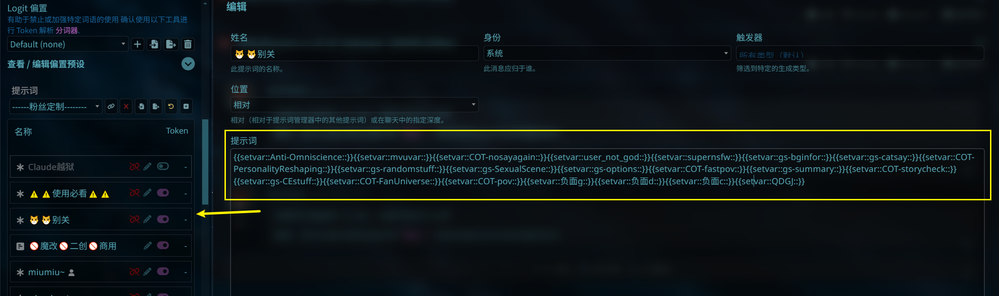

# 前言

## 叠甲

本教程为简单缝合预设教程

## 须知

酒馆预设条目类似于拼积木, 大部分条目没有严格的顺序要求(初始化变量这些除外), 这里不说那么多, 在开始前我们需要先知道几个东西↓

var: 也就是变量, 分为全局变量和局部变量, 主要用于存储数据, 将它想象成一个可以存取物品的容器即可

getvar: 从容器中获取数据

setvar: 在容器中放入数据

只需要知道这些概念, 就足够了

# 教程

本教程演示采用预设: TG猫Claude版


假设我们想缝一个叫做"防阳光"的条目, 这个条目的内容只有
```
- 情绪修正: 
  体现世界真实性，任何角色都会出现对应的负面/极端情绪，避免出现任何“童话感”或“温馨日常”场景
- 性格修正:
  体现世界残酷性，任何角色以利益为先，不体现任何温情
```

1. 第一步, 找到初始化变量条目

   它的名字可能不叫"初始化变量", 但一般来说就在预设的前面几条


